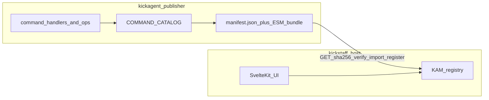

# Kickagent + kickstaff: ecosystem summary

**Read first (product story):** [kam-suite-vision.md](kam-suite-vision.md) — KAM Suite wrapper, Alpha today, public Beta placeholders, path to a broader service.

Kick Asset Management’s product is built as **two cooperating applications**: **kickstaff** (the authenticated web experience) and **kickagent** (the capability and operations layer). This page explains that split in two passes—**The pitch** for business readers, **The details** for engineers. Stop after the pitch if you only need the “why”; continue for contracts, phases, and tradeoffs.

**Slides:** [kam-ecosystem-pitch-deck.html](kam-ecosystem-pitch-deck.html) (reveal.js pitch deck — open in a browser; requires network for CDN assets). **Wiki:** [wiki viewer](../wiki/) — `pnpm kam:wiki` → http://127.0.0.1:7097/wiki/

---

## The pitch

Most software teams integrate features through a familiar pattern: publish a REST API, maintain documentation, ship SDK versions, and ask every consumer to redeploy when something new ships. Documentation drifts from reality. Both sides carry versioning baggage. Everyone waits on everyone else.

We took a different shape for operations inside the product—without asking users to notice two apps.

**kickstaff** is what people log into: marketing sites, admin, the ops hub, and the **KAM** command console (palette, logs, session). It owns authentication, layouts, and the shell around the experience.

**kickagent** is where operational work lives: KAM commands, business logic, data pipelines, and (over time) bills, units, ETL, and long-running jobs. It does not own the browser UI; it publishes **capabilities** the host can load.

Day to day, kickagent authors add or change commands in one catalog. When they publish, they ship a small **manifest**—a machine-readable list of what exists, where the code lives, and a cryptographic fingerprint of that code. kickstaff **reloads** that manifest. New commands appear in the palette and hub; handler fixes can land **without rebuilding the entire web application** for every kickagent release. One team owns “what the product can do”; the other owns “how it looks and who is allowed in.”

That matters for speed and clarity. There is a single source of truth for which commands exist and how they are described—no parallel wiki and no hand-maintained integration checklist in the host repo for every new command. Ownership is obvious: if it runs as `kickagent:*` in KAM, it belongs in kickagent; if it is a page, login, or shell behavior, it stays in kickstaff.

This is not magic “zero deploy.” The web host still owns sign-in, routes, and product chrome. Some features still need host code—for example, rich tables driven by new resource types. But the **routine loop**—ship command logic, publish, reload—stays on the provider side instead of blocking on a full consumer release cycle.

Long-running job streaming through a dedicated kickagent API is on the roadmap; today’s primary path is the published manifest and dynamic plugin load described below.

---

## The details

### How the pieces connect

### Contract model (Phase 2 — primary today)

kickagent publishes two artifacts on a fixed origin (local **7099**, or HTTPS on Railway in production):

| Artifact | Role |
| -------- | ---- |
| **`manifest.json`** | Version, `moduleUrl`, `sha256`, `commands[]`, optional `resources`, optional `api.baseUrl` |
| **`kickagent-<semver>.esm.js`** | ESM bundle exporting **`register(registry, ctx)`** |

The host:

1. `GET`s the manifest.
2. Fetches module bytes and verifies **`sha256`** before `import()`.
3. Calls **`register(registry, hostContext)`** so `kickagent:*` handlers attach to the KAM registry.

After a kickagent release, operators run **`kam:reload-kickagent`**: unregister prior `kickagent:*` commands, refetch manifest, verify hash, re-import, re-register—without bumping an npm dependency or rebuilding kickstaff for that workflow.

**Single catalog truth:** [`src/commands/index.ts`](../../src/commands/index.ts) defines **`COMMAND_CATALOG`**. That list drives plugin registration, `manifest.json` `commands[]`, and generated [`kickagent/commands/reference.md`](../kickagent/commands/reference.md). Do not hand-edit published command lists.

Manifest fields are defined in [`src/manifest.ts`](../../src/manifest.ts) (`KickagentManifest`: version, `moduleUrl`, `sha256`, `minHostVersion`, `commands`, optional `resources`, optional `api`).

**Manifest vs plugin:** `commands[]` describes the full catalog. The ESM bundle registers only browser-safe handlers; other commands run server-side via **`POST /api/kickagent/run`** (kickstaff proxy to kickagent). See [kickagent/architecture/kickstaff-integration.md](../kickagent/architecture/kickstaff-integration.md).

### Responsibility split

| Concern | kickstaff (host) | kickagent (publisher) |
| ------- | ---------------- | --------------------- |
| **Product UI** | SvelteKit routes, marketing, hub, KAM shell | No UI coupling |
| **Auth & sessions** | Cookie sessions, gates | Receives `userId` / `userEmail` via host context only |
| **KAM shell** | Palette, klog, host commands (`help`, `kam:reload-kickagent`, …) | `register()` and handler implementations |
| **Command catalog** | Consumes manifest; hub cards from catalog metadata | **Source of truth:** `COMMAND_CATALOG` |
| **Plugin artifacts** | Fetch, verify, `import()`, reload | Build `publish/manifest.json` + ESM bundle |
| **Ops data & secrets** | Product DB (users, klogs, links) | Operations schema, S3, API keys, workers (target domain) |

**Rule of thumb:** `kickagent:*` in the palette → implement in kickagent. Pages, auth, shell UX → kickstaff.

### Integration phases

| Phase | Status | Summary |
| ----- | ------ | ------- |
| **1 — npm package** | Working | kickstaff imports `kickagent` via package link; static `register` on login. Good for local dev and minimal wiring. |
| **2 — manifest + dynamic plugin** | **Primary path** | Published manifest + ESM; republish + `kam:reload-kickagent`. |
| **3 — HTTP job API** | **Planned** | `POST /v1/jobs`, SSE, kickstaff `/api/kickagent/*` proxy for long `execution: "remote"` work. Spec: [kickagent/architecture/platform-spec.md](../kickagent/architecture/platform-spec.md). |

### Compared with conventional REST / OpenAPI services

| Topic | Conventional API service | kickagent + kickstaff |
| ----- | ------------------------ | --------------------- |
| **Contract discovery** | OpenAPI, wiki, SDK versions | Published `manifest.json` + catalog metadata |
| **Consumer update for new operations** | Often new client deploy | Often reload + republished artifact |
| **Command UX in the product** | Custom per integration | KAM palette and hub from manifest metadata |
| **Compatibility** | Versioned endpoints, deprecation periods | `minHostVersion`, stable `register()` API, manifest schema evolution |
| **What still needs host work** | BFF, auth, UI | Loader, integrity check, `/api/kickagent/run` proxy, resource UIs for new `presentationRef` types |

Backward compatibility does not disappear—it moves to the manifest and `register()` boundary. Breaking those contracts still requires coordinated kickstaff work.

### Operational loop (dev and prod)

1. **kickagent:** `pnpm build` → publish artifacts (`publish:artifacts` / Kickdesk **Republish** or **`p`** when 7099 is up).
2. **Serve contract:** `serve-publish` on **7099** locally, or Railway `prestart` + `serve-publish` in production ([kickagent/operations/deployment-railway.md](../kickagent/operations/deployment-railway.md)).
3. **kickstaff:** `PUBLIC_KICKAGENT_MANIFEST_URL` points at `…/manifest.json`.
4. **Reload:** `kam:reload-kickagent` (or equivalent on admin bootstrap).

**Two different “manifest” files:** Kickdesk’s cockpit file at `~/.config/kickagent/manifest.json` (ports, shell workflows) is **not** the HTTP plugin contract at `http://127.0.0.1:7099/manifest.json` (or your Railway URL)—hosts consume only the published HTTP manifest.

### Caveats (read before you pitch Phase 3)

- **Phase 3 is not shipped**—do not assume job API or SSE proxy exists yet.
- **Not every command runs in the browser bundle**—server execution and secrets stay off the client.
- **New presentation or resource types** may still need kickstaff routes and components (e.g. units table UI).
- **Credibility over hype:** this architecture optimizes **command catalog velocity and clear ownership**; it does not remove the need for a capable host implementation once.

---

## Where to go next

- **KAM Suite product vision:** [kam-suite-vision.md](kam-suite-vision.md)
- **Kickagent docs home:** [../kickagent/README.md](../kickagent/README.md)
- **Architecture map (agents):** [../kickagent/architecture/overview.md](../kickagent/architecture/overview.md)
- **kickstaff host integration:** [../kickagent/architecture/kickstaff-integration.md](../kickagent/architecture/kickstaff-integration.md)
- **Load / reload steps:** [../kickagent/architecture/plugin-manifest-and-reload.md](../kickagent/architecture/plugin-manifest-and-reload.md)
- **Add a command and publish:** [../kickagent/commands/adding-commands.md](../kickagent/commands/adding-commands.md)
- **Platform spec and Phase 3 draft:** [../kickagent/architecture/platform-spec.md](../kickagent/architecture/platform-spec.md)
- **Manifest resources (units UI):** [../kickagent/architecture/manifest-resources.md](../kickagent/architecture/manifest-resources.md)
- **Ports (7099 / 7098 / 7097):** [../kickagent/architecture/ports.md](../kickagent/architecture/ports.md)
