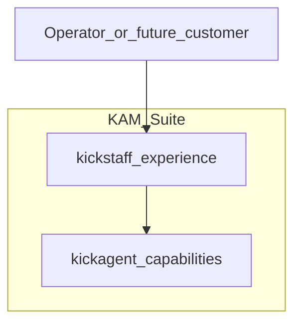

# KAM Suite — product vision

**KAM Suite** is the product name for what operators experience day to day: one operational workspace backed by **two independent codebases**—**kickstaff** (experience) and **kickagent** (capabilities). This document describes *why* the suite exists, who it serves today, and how release stages move from in-house **Alpha** toward a **public Beta** and a broader hosted service. It does not replace the integration story; that lives in [kam-ecosystem-marketing.md](kam-ecosystem-marketing.md).

**Who this is for:** you (primary operator), future collaborators, and anyone evaluating whether KAM Suite could serve customers beyond the first workflow.

---

## The product wrapper

Users and stakeholders should think in terms of **KAM Suite**, not “two repos.” Under the hood:

| Layer | Component | Role |
| ----- | --------- | ---- |
| **Experience** | **kickstaff** | Sign-in, marketing sites, ops hub, KAM console (palette, logs, layouts) |
| **Capabilities** | **kickagent** | Commands, business logic, data pipelines, ops schema (bills, units, ETL over time) |

The wrapper is **conceptual and operational**, not a third application repository. kickstaff and kickagent deploy and version independently; the suite is held together by a documented contract (published manifest, plugin load, host reload) described in [kam-ecosystem-marketing.md](kam-ecosystem-marketing.md) § The details.

**Kick Asset Management** remains the business context; **KAM Suite** is the software product that embodies it for operators.

---

## Built for one workflow (Alpha)

KAM Suite is developed **in-house** for a **single primary operator** whose real workflow drives priorities. Features are chosen because they remove friction in that workflow—not because a roadmap committee demanded parity with a competitor.

**What Alpha means today:**

- Fast iteration over polish; rough edges are acceptable when the command or data path works.
- **Workflow-first:** if it does not help the operator’s day, it waits.
- **Single-tenant mindset:** one trusted user, no productized onboarding, no commercial SLA.
- **Sibling repos:** kickstaff on the host side, kickagent as publisher; local Kickdesk republish and `kam:reload-kickagent` for tight dev loops.
- **Honest limits:** multi-customer isolation, self-service sign-up, and long-running job APIs are **not** product promises in Alpha unless explicitly built and documented elsewhere.

Alpha is the stage where the suite proves it can run the business operation—not where it proves it can run ten thousand tenants.

---

## Path to a broader service

The bet is simple: capabilities forged in one demanding workflow will have **general appeal** for property and asset operators (and adjacent roles). Commands, units tooling, bill pipelines, and hub-style ops patterns are not quirks of a single user; they are candidates for a **hosted product** others can subscribe to.

**What changes when moving from personal tool to product:**

| Dimension | Alpha (now) | Broader service (target) |
| --------- | ----------- | ------------------------ |
| **Users** | One primary operator | Many accounts, possibly organizations |
| **Trust** | Implicit | Explicit auth, isolation, audit |
| **Deploy** | Operator-controlled | Hosted KAM Suite with stable URLs and rollback |
| **Support** | Ad hoc | Documented onboarding, help channel, status |
| **Architecture** | kickstaff + kickagent contract | Same split; manifest/plugin model can theoretically host capabilities on other shells—out of scope until needed |

Deployment vision stays **high level** until Beta planning hardens: a hosted **kickstaff** front door, a published **kickagent** contract on HTTPS (see [kickagent/operations/deployment-railway.md](../kickagent/operations/deployment-railway.md)), and secrets plus ops data staying on the provider side. Do not read this section as a commitment to multi-host marketplaces or Phase 3 job APIs—they remain roadmap items per [kickagent/architecture/platform-spec.md](../kickagent/architecture/platform-spec.md).

---

## Release stages

| Stage | Status | Summary |
| ----- | ------ | ------- |
| **Alpha** | **Now** | In-house, single-operator workflow; two repos; manifest + dynamic plugin (Phase 2) as primary integration path. |
| **Public Beta** | **Target** | Invited or open testers outside the founding operator; minimum bars in the next section—**placeholders until you fill them in**. |
| **GA / hosted service** | **Future** | Repeatable provisioning, commercial or licensed offering if desired, operational maturity across security, reliability, and support. Intentionally light on detail until Beta teaches what customers actually need. |

---

## Public Beta — requirements (draft)

Edit the `[TBD]` lines below when you define the Beta bar. Nothing in this section is claimed as **shipped** today.

### Identity and access

- [TBD] Multi-user authentication beyond a single admin seed
- [TBD] Roles or permissions (who can run destructive commands, see financial data, etc.)
- [TBD] Session security baseline (rotation, secure cookies, production secrets discipline)

### Tenant and data isolation

- [TBD] Per-customer or per-org data boundaries if Beta serves more than one operator
- [TBD] Clear dev vs prod separation for operators and hosts
- [TBD] Migration and backup story for ops schema (kickagent-owned data)

### Reliability and operations

- [TBD] Monitoring and alerting on host + kickagent contract availability
- [TBD] Backup/restore tested for databases and critical object storage
- [TBD] Incident response path (who gets paged, how to roll back manifest/plugin)

### Product and onboarding

- [TBD] Operator-facing documentation (getting started, command catalog, limitations)
- [TBD] Sign-up or invite flow if Beta is not single-tenant
- [TBD] Support channel (email, ticket, or office hours)

### Security and compliance

- [TBD] Secrets never in browser bundles; server-side execution paths documented
- [TBD] Audit trail for sensitive commands or data changes
- [TBD] Minimum privacy/terms posture if external users touch production data

### Platform and deploy

- [TBD] Production manifest URL and CORS aligned with kickstaff origin(s)
- [TBD] CI publish + verified `sha256` on each release
- [TBD] Documented reload or bootstrap path for hosts after kickagent deploy

### Commercial (optional)

- [TBD] Pricing model, billing integration, or “free Beta” terms
- [TBD] License or acceptable-use language if required

---

## How this connects to the stack

| Document | Answers |
| -------- | ------- |
| **This file** (`kam-suite-vision.md`) | *Why* KAM Suite exists, *who* it serves, *when* Alpha → Beta → service |
| [kam-ecosystem-marketing.md](kam-ecosystem-marketing.md) | *How* kickstaff and kickagent integrate—the pitch and technical details |
| [kam-ecosystem-pitch-deck.html](kam-ecosystem-pitch-deck.html) | Slide-friendly version of the architecture pitch |
| [kickagent/architecture/overview.md](../kickagent/architecture/overview.md) | Contributor architecture map and responsibility split |

Read **vision first** for product story; read **kam-ecosystem-marketing** for the two-app contract and reload loop.
