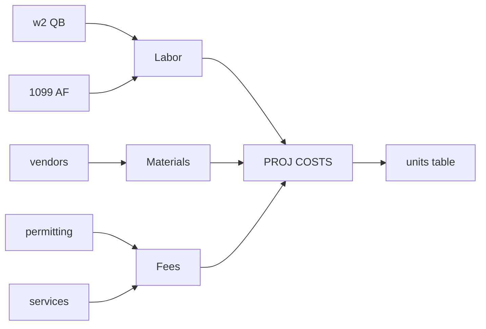
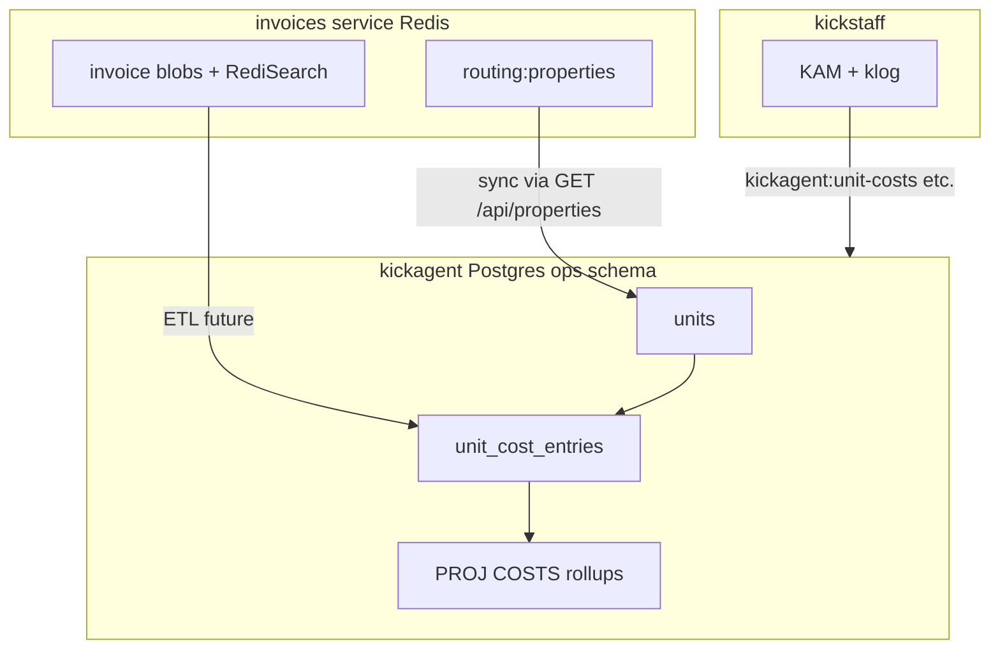
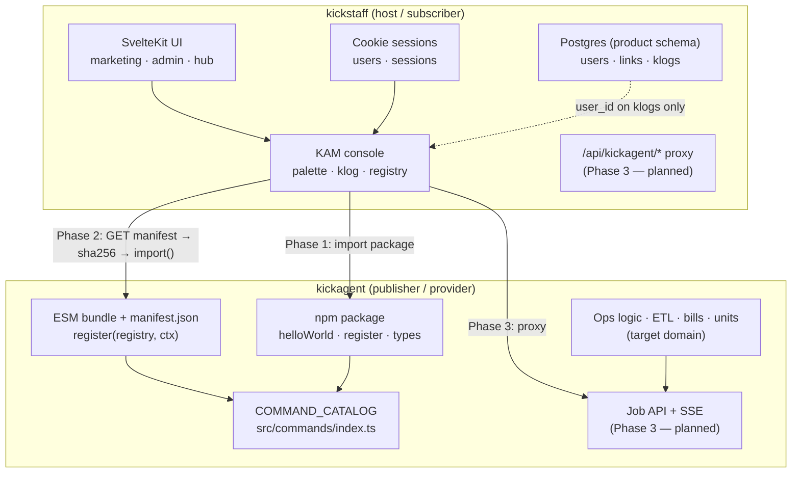

# Project costs — situation summary

We need to track **project costs (PROJ COSTS)** per real estate **unit** — a housing asset the org owns. Each unit carries a total built from three buckets:

- **Labor** — W2 (QuickBooks) + 1099 (AppFolio)
- **Materials** — vendor invoices
- **Fees** — permitting, services



## Three systems, one real-world entity

| System | Repo | Role for project costs |
| ------ | ---- | ---------------------- |
| **kickstaff** | sibling | KAM host + UI shell; **not** the ops engine |
| **kickagent** | this repo | **Owner** of `units` Postgres schema, cost ledger, ETL, KAM commands |
| **invoices** | git submodule [`invoices/`](../../invoices/) (`Kick-Asset-Management/invoices`) | Live AP ops service: invoice ingest, vendor search, **property routing rules** in Redis |

**Naming rule (locked):** table is **`units`** in kickagent Postgres. Invoices Redis/API uses **`properties`** (routing vocabulary). Vendor document fields use **`property`** as a parsed tag. These refer to the same real-world housing asset via a **link field**, not one shared table name.

## What already exists vs what is greenfield

**Exists today (invoices submodule):**

- ~100 property records in Redis key `routing:properties` ([`invoices/routing.js`](../../invoices/routing.js))
- Each record: slug `id`, `name`, `aliases`, QB customer/class/account ids, AF property mapping, push flags
- HTTP API documented in [`docs/invoicesAPI.md`](../invoicesAPI.md): `GET /api/properties`, `GET /api/properties/:id/invoices`, search endpoints
- Auth: shared password session (`INVOICE_PASSWORD` → `connect.sid` cookie); server-to-server only, no API key yet

**Does not exist yet:**

- kickagent **operations Postgres schema** (no Drizzle/migrations in repo yet)
- `units` table or `unit_cost_entries` ledger
- PROJ COSTS rollups (labor/fees arms especially)
- kickagent code that calls the invoices API

**Partial signal available:** invoices can match vendor spend to a property (materials-ish); it does **not** maintain cost totals or read W2/1099 payroll.

## Recommended architecture (link, don't duplicate)



Principles:

- **kickagent Postgres `units`** = canonical cost entity + rollups
- **invoices `routing:properties`** = source of truth for routing identity and QB/AF ids (until office workflow migrates)
- Link via `units.invoices_property_id` → slug like `432-434-e-8th-st`
- **kickstaff** displays via KAM first; no direct invoices API from browser (no CORS; secrets stay server-side)
- Prefer **HTTP API** over direct Redis reads from kickagent

## Cost sources → implementation order

| Bucket | Source | v1 feasibility |
| ------ | ------ | -------------- |
| Materials | Invoices vendor indexes + matched pipeline invoices | Partial — needs ETL/aggregation in kickagent |
| Fees | Categorized vendor spend (permitting, services) | Same path as materials with category rules |
| Labor W2 | QuickBooks | Not in invoices rollups; use `qbCustomerId` on property record as join key |
| Labor 1099 | AppFolio | Not in invoices rollups; use `afPropertyId` / `afPropertyName` as join key |

Suggested phasing:

1. **Entity layer** — Postgres `units` seeded/synced from `GET /api/properties`
2. **Ledger stub** — `unit_cost_entries` + manual or imported rows; computed PROJ COSTS
3. **Materials ETL** — pull invoice evidence from invoices API/search
4. **Labor ETL** — QB/AF pulls using ids already on property records
5. **KAM command** — e.g. `kickagent:unit-costs <slug>` logs breakdown (no kickstaff UI required for v1)
6. **kickstaff surface** — optional later via proxy or Phase 3 job API

## Units v1 (implemented)

AppFolio CSV import maps into kickagent `units` with all export fields on that table:

- **`name`** ← CSV `Name` (legacy `Property` header still accepted)
- **`property_address`** ← CSV `Property Address`
- **`appfolio_property_id`** ← optional cross-reference to AppFolio (nullable; blank in CSV stays null)
- Remaining AF columns (rent, fees, owners, etc.) stored on `units` as typed fields + `source_payload`

Import behavior:

- Rows **with** AF id: upsert by `appfolio_property_id`
- Rows **without** AF id: insert with null id (no synthetic fallback id)
- CLI: `kickagent:units-import-af`, `kickagent:units-list`, `kickagent:units-show`, `kickagent:units-update`, `kickagent:units-metadata`
- DB targeting: see [database-targeting.md](../database-targeting.md); table detail: [units-table.md](../units-table.md)

## Open decisions

- Unit granularity: one row per address vs parent/sub for renovation phases (alias CSV implies hierarchy)
- Time scope: lifetime capex vs renovation window vs fiscal year
- Computed rollups only vs cached columns on `units`
- Whether kickagent ever writes back to invoices `routing:properties` (today: invoices UI owns routing edits)
- Machine-to-machine auth for invoices API (password session is fine for v1, weak for cron ETL)

## Key references

- Cross-app boundary: [kickagent/architecture/overview.md](../kickagent/architecture/overview.md), [kickstaff-integration.md](../kickagent/architecture/kickstaff-integration.md)
- Invoices consumer contract: [`docs/invoicesAPI.md`](../invoicesAPI.md)
- Invoices property model: [`invoices/routing.js`](../../invoices/routing.js), [`invoices/readme.markdown`](../../invoices/readme.markdown)
- Submodule: [`.gitmodules`](../../.gitmodules)

---
---

Some sketchy notes for me to scribble on, partly from other docs.



---

## One sentence each

| App           | Role                                                                                                                                                                        |
| ------------- | --------------------------------------------------------------------------------------------------------------------------------------------------------------------------- |
| **kickstaff** | Authenticated web product: rental marketing, admin, ops hub, and **KAM host** (UI + command registry + klog). Owns auth, layouts, and host meta-commands.                   |
| **kickagent** | **KAM command provider**: library + plugin bundle + (future) ops engine. Owns `kickagent:*` implementations, `COMMAND_CATALOG`, manifest publishing, and long-running work. |

**kickstaff is not the office-operations engine.** Bills, units, ETL, S3 pipelines, and the operations Postgres schema are kickagent’s domain. kickstaff dropped legacy `/tools/*` and ops tables (migration 0019); kickagent is meant to recreate that world on its side of the boundary.

---

## Responsibility split (for agents)

| Concern              | kickstaff owns                                                                                                             | kickagent owns                                                                   |
| -------------------- | -------------------------------------------------------------------------------------------------------------------------- | -------------------------------------------------------------------------------- |
| **UI**               | SvelteKit routes, layouts, marketing pages (`cda`/`mos`/`spt`), admin, hub linkboard                                       | None (no UI coupling)                                                            |
| **Auth**             | Cookie sessions, argon2, `hooks.server.ts` gate                                                                            | Receives `userId` / `userEmail` via `KickagentHostContext` only                  |
| **KAM shell**        | Palette, console, klog display, `/api/klogs`, host commands (`help`, `shell`, `kam:reload-kickagent`, `alias`, `db`, …)    | Plugin `register(registry, ctx)` and handler implementations                     |
| **Command names**    | Prefixes short names → `kickagent:hello`                                                                                   | Defines short names in catalog (`hello`, `units-*`, …)                               |
| **Command catalog**  | Consumes manifest / calls `register`; materializes hub command cards from catalog metadata                                 | **Source of truth:** `src/commands/index.ts` → `COMMAND_CATALOG`                 |
| **Plugin artifacts** | Fetches manifest, verifies `sha256`, dynamic `import(moduleUrl)`, reload flow                                              | Builds `publish/kickagent-<semver>.esm.js` + `publish/manifest.json`             |
| **Database**         | Product schema: `users`, `sessions`, `rental_landing_links`, `dashboard_links`, `user_dashboard_link_preferences`, `klogs` | Operations schema (target): bills, units, ETL, etc.—**not** in kickstaff Drizzle |
| **Secrets / infra**  | `DATABASE_URL`, session secrets, vanity hosts                                                                              | S3, Redis (future), API keys, job workers, ops env vars                          |
| **Long jobs**        | Proxy + SSE → klog (Phase 3 planned)                                                                                       | Job API, workers, streaming events                                               |
| **Local dev ports**  | App on **5000**; Postgres **5043**                                                                                         | Publish server **7099**; standalone harness **7098**                             |

**Rule of thumb for agents:** If it appears in the KAM palette as `kickagent:*`, implement it in kickagent. If it’s shell UX, auth, or a web page, it stays in kickstaff.

---

## Integration phases (current → planned)

### Phase 1 — npm package (working today)

- kickstaff depends on kickagent via `link:../kickagent`.
- On admin login, kickstaff imports `register` and catalog types from the package and wires commands into the KAM registry (static registration).
- Good for: local dev, manual wiring, testing `helloWorld`-style functions without manifest machinery.

### Phase 2 — manifest + dynamic plugin (working / primary path)

1. kickagent builds artifacts: `pnpm build` → `bundle` → `publish --base-url …` → optional `serve-publish` on **7099**.
2. kickstaff sets `PUBLIC_KICKAGENT_MANIFEST_URL` (e.g. `http://127.0.0.1:7099/manifest.json`).
3. Host flow: `GET manifest` → verify `sha256` on bundle bytes → `import(moduleUrl)` → `register(registry, ctx)`.
4. After code changes: **Republish** (Kickdesk `p` or CLI) → **`kam:reload-kickagent`** in kickstaff. No kickstaff rebuild required for handler changes.

**Single catalog truth:** `COMMAND_CATALOG` drives plugin registration, `manifest.json` `commands[]`, and generated `docs/kickagent/commands/reference.md` (`pnpm docs:commands`). Do not hand-edit manifest command lists.

### Phase 3 — HTTP job API (planned, not implemented)

- kickagent exposes `/v1/jobs` + SSE for `execution: "remote"` commands.
- kickstaff proxies via `/api/kickagent/`\*; browsers never hold KA secrets.
- Until this exists, treat all commands as **local** (`execution: "local"`) from the host’s perspective.

---

## KAM command flow (end-to-end)

```
User types in KAM palette (kickstaff)
        │
        ├─ bare name "hello"     → kickagent:hello  (plugin handler)
        ├─ ":help"               → kickstaff host command
        └─ "kam:reload-kickagent"→ kickstaff host command (refetch plugin)
```

**Handler context** (`KickagentHostContext`): `userId`, `userEmail`, `logger` (`KlogBroadcaster`), optional `apiBaseUrl`. Handlers log via `logger.info/warn/error`—never `console.log` in exported business logic.

**Hub cards:** kickstaff lazily materializes dashboard command cards from catalog metadata (`category`, `description`, `sortOrder`) on first run—not from duplicate kickstaff-side definitions.

---

## Database: one server, two owners

Same Postgres instance (`DATABASE_URL` / local **5043**) can host both apps, but **schema ownership is split by convention**, not cross-app FKs:

| Schema owner           | Tables / purpose                                                                                  |
| ---------------------- | ------------------------------------------------------------------------------------------------- |
| **kickstaff**          | Auth, marketing links, hub links, per-user preferences, klogs (tied to `user_id`)                 |
| **kickagent** (target) | Bills, units, ETL runs, object metadata, ops audit—replaces what left kickstaff in migration 0019 |

**Agent constraints:**

- kickagent must **not** read/write kickstaff tables except via documented cross-boundary patterns (e.g. `user_id` on audit/klog-style rows).
- S3 and bill-pipeline env belong in **kickagent** deploy config, not `kickstaff/.env.example`.
- kickstaff’s KAM `db use dev|prod` is a **dev convenience** for kickstaff developers—not kickagent schema management.

---

## Adding a new kickagent command (agent checklist)

Cross-repo workflow both teams document:

1. **kickagent:** `src/commands/<name>.command.ts` → append to `COMMAND_CATALOG` in `src/commands/index.ts`.
2. **kickagent:** `pnpm docs:commands`; bump version; `publish:artifacts` (or Kickdesk republish).
3. **kickstaff:** No manual per-command registration in Phase 2—reload picks up catalog from manifest.
4. **Verify:** Run command in KAM; check klog output; optional hub card if `category` is set.
5. **Optional:** Hub card appears from catalog metadata without kickstaff code changes.

Docs to follow:

- kickagent: `docs/kickagent/commands/adding-commands.md`, `docs/appendix/AGENTS.md`
- kickstaff: `docs/guides/register-kickagent-command.md`, `docs/guides/contracts/kickstaff-kickagent-consumer.md`

---

## Build / dev loop (both repos)

| Step           | Where     | Command / note                                                     |
| -------------- | --------- | ------------------------------------------------------------------ |
| Install & DB   | kickstaff | `pnpm install`, `pnpm db:up`, `pnpm db:migrate`, `pnpm seed:admin` |
| Sibling link   | kickstaff | Requires `../kickagent` linked in `package.json`                   |
| Build KA       | kickagent | `pnpm build`                                                       |
| Publish plugin | kickagent | `pnpm publish:artifacts -- --base-url http://127.0.0.1:7099`       |
| Serve manifest | kickagent | `pnpm serve-publish` (7099)                                        |
| Run host       | kickstaff | `pnpm dev` → [http://localhost:5000](http://localhost:5000)        |
| Hot reload     | both      | Kickdesk republish + `kam:reload-kickagent`                        |

---

## Mental model for feature design

When scoping a new feature, ask:

1. **Does the user see it in a browser?** → kickstaff (route, component, KAM shell).
2. **Does it run as a KAM command?** → kickagent (catalog entry + handler + tests).
3. **Does it touch bills/units/ETL/S3?** → kickagent only; kickstaff gets a thin proxy or KAM trigger.
4. **Does it need persistence?** → Which schema? Product (kickstaff) vs operations (KA)—never mix without an explicit contract.
5. **Does it need secrets or minutes of compute?** → kickagent (+ Phase 3 proxy), not kickstaff client code.

That’s the combined picture: **kickstaff hosts the experience and trust boundary; kickagent publishes capabilities and owns operational depth.** Agents should treat the contract docs and `COMMAND_CATALOG` as the seam—not shared code or shared tables.

When you’re ready to talk new features, describe what the user should see and what should run where; we can map it to this split quickly.
